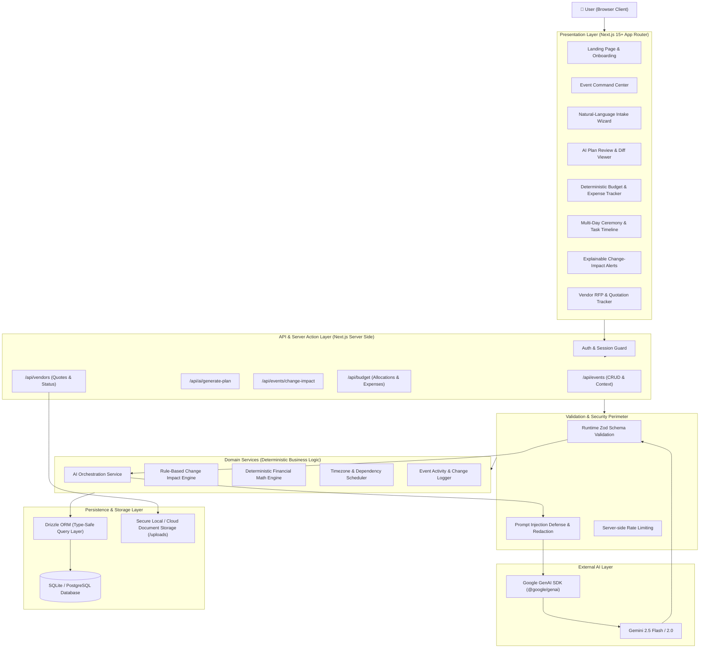
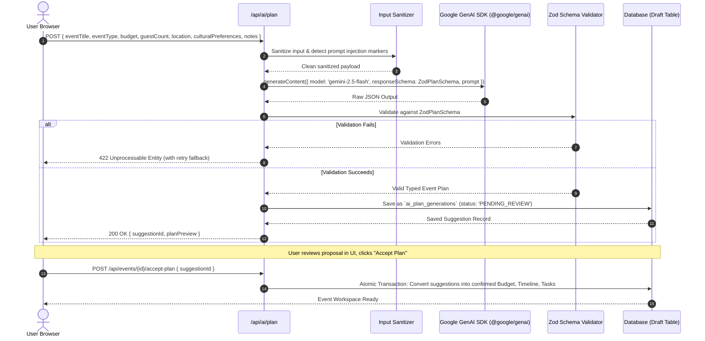
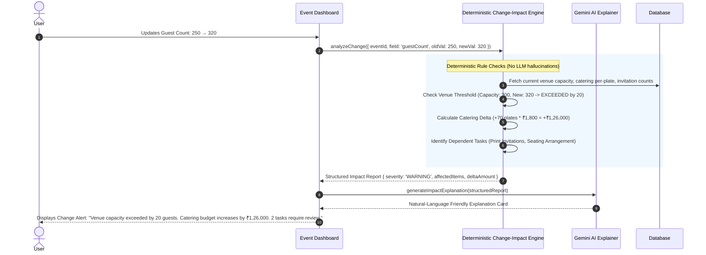

# Gatherly AI — System Architecture

This document defines the structural blueprint, technical boundaries, security perimeter, and data flows for **Gatherly AI**.

---

## 1. High-Level Architecture Diagram



---

## 2. Component & Module Layout

The codebase follows a clean, modular monolith design inside `src/`:

```
src/
├── app/                              # Next.js App Router (Pages, Layouts, API Routes)
│   ├── (auth)/                       # Login, Register, Profile
│   ├── (dashboard)/                  # Authenticated Workspace
│   │   ├── events/                   # Event List & Creation
│   │   ├── events/[eventId]/         # Event Command Center
│   │   │   ├── budget/               # Budget & Expense Management
│   │   │   ├── timeline/             # Multi-Day Timeline & Tasks
│   │   │   ├── vendors/              # Vendor RFP & Quotations
│   │   │   ├── guests/               # Guest & Dietary Management
│   │   │   ├── impact/               # Change Impact Intelligence
│   │   │   └── settings/             # Cultural, Timezone, Currency Config
│   │   └── layout.tsx                # Dashboard Layout with Navigation
│   ├── api/                          # REST / JSON API Endpoints
│   │   ├── events/                   # Event CRUD
│   │   ├── ai/plan/                  # AI Intake & Structured Plan Generation
│   │   ├── ai/impact/                # AI Change Impact Explanations
│   │   └── vendors/quotes/           # Quote Upload & Processing
│   ├── globals.css                   # Tailwind CSS Theme & Styling
│   └── layout.tsx                    # Root HTML Layout
│
├── components/                       # UI Components (Accessible & Modular)
│   ├── ui/                           # Base design primitives (Button, Card, Modal, Input, Badge, Table)
│   ├── event/                        # Event creation wizards, summaries, preference selectors
│   ├── budget/                       # Category bars, expense forms, currency formatters
│   ├── timeline/                     # Ceremony cards, task checklists, dependency indicators
│   ├── impact/                       # Impact diff callouts, warning banners, actionable suggestions
│   └── vendors/                      # Quote comparison tables, status pills, RFP builders
│
├── lib/                              # Core Infrastructure & Cross-Cutting Concerns
│   ├── db/                           # Database Schema & Migrations
│   │   ├── schema.ts                 # Drizzle Schema Definitions
│   │   ├── index.ts                  # Database Connection Instance
│   │   └── migrations/               # Versioned SQL Migrations
│   ├── ai/                           # GenAI Service Layer
│   │   ├── gemini.ts                 # Google GenAI SDK Client Initialization
│   │   ├── prompts.ts                # Structured Prompts & System Instructions
│   │   └── schemas.ts                # Zod Schemas for Structured AI Outputs
│   ├── domain/                       # Pure Deterministic Business Logic
│   │   ├── budget.ts                 # Integer-paise budget arithmetic & allocations
│   │   ├── impact-engine.ts          # Rule-based change impact detection
│   │   ├── timeline.ts               # Date math, relative offsets, dependency resolution
│   │   └── formatting.ts             # Currency (INR ₹, Lakhs/Crores, USD, EUR), Date (Asia/Kolkata)
│   ├── auth/                         # Authentication & Event-Level Access Control
│   │   ├── session.ts                # Session retrieval & identity validation
│   │   └── permissions.ts            # RBAC & Event-Ownership authorization guards
│   └── utils/                        # Sanitizers, error handlers, string helpers
│
└── tests/                            # Comprehensive Automated Test Suites
    ├── unit/                         # Unit tests (Budget math, impact rules, date calculations)
    ├── integration/                  # DB query tests, schema constraints, migration checks
    └── security/                     # Injection defenses, cross-user isolation tests
```

---

## 3. Data Flow & Request Lifecycles

### 3.1 AI Plan Generation Lifecycle



---

### 3.2 Change-Impact Intelligence Lifecycle



---

## 4. Deterministic Core vs. Generative AI Separation

To ensure rock-solid financial, legal, and operational reliability, Gatherly establishes an impermeable boundary between deterministic code and AI reasoning:

| Responsibility | Handled By | Why This Boundary Matters |
| :--- | :--- | :--- |
| **Summing Budget Allocations** | Deterministic Code | AI arithmetic is non-deterministic and hallucination-prone. |
| **Checking Venue Capacity Thresholds** | Deterministic Code | Capacity safety is a hard constraint governed by strict numerical comparison. |
| **Calculating Days Until Deadlines** | Deterministic Code | Calendar date math must handle leap years, timezones, and day boundaries accurately. |
| **Enforcing Confirmed Vendor Contracts** | Deterministic Code | Confirmed quotes and expenses are legally sensitive; cannot be overwritten by AI. |
| **Suggesting Themes, Menus, Activities** | Google Gemini (`@google/genai`) | High creative value; AI synthesizes cultural traditions and fresh ideas. |
| **Drafting Initial Itinerary & Checklist** | Google Gemini (`@google/genai`) | Rapidly bootstraps 80% of planning effort from natural language. |
| **Summarizing Vendor Quotations** | Google Gemini (`@google/genai`) | High language comprehension; extracts inclusions/exclusions from unformatted text. |
| **Explaining Change Impact in Plain English** | Google Gemini (`@google/genai`) | Translates complex relational deltas into calming, human-readable guidance. |

---

## 5. Database & Authorization Architecture

- **ORM & Dialect:** Drizzle ORM provides zero-overhead, type-safe queries with explicit migrations. Dialect supports SQLite for local lightweight development/testing and PostgreSQL for enterprise production.
- **Tenant & Event Isolation:**
  - Every resource (`Budget`, `Task`, `Expense`, `VendorQuote`, `Guest`) carries an immutable `event_id` foreign key.
  - Every API route and Server Action validates that the calling session is the owner or an authorized collaborator of `event_id` before executing any query or mutation.
  - Defense against IDOR (Insecure Direct Object Reference) is enforced at the repository and middleware layer, never solely by hiding UI buttons.
- **Audit Logging:** Every major mutation creates an entry in `event_activities` capturing `actor_id`, `action`, `entity_type`, `before_state`, and `after_state`.

---

## 6. Financial Architecture & Money Rules

1. **Integer Minor-Unit Representation:** All currency amounts are stored as integers representing the smallest currency unit (paise for INR, cents for USD/EUR):
   - Example: ₹15,00,000 is stored as `150000000` (paise).
2. **Deterministic Statuses:**
   - `PLANNED`: Total ceiling cap allocated to the event or category.
   - `ESTIMATED`: Rough initial guideline generated by AI or user prior to quotes.
   - `QUOTED`: Vendor bid received and logged into system.
   - `CONFIRMED`: Legally agreed amount with a designated vendor.
   - `PAID`: Actual funds disbursed to date.
   - `CONTINGENCY`: Dedicated buffer reserve (default 10%–15% recommended for weddings).
3. **Indian Number Formatting:** Native formatting supporting the Indian numbering system (Lakhs and Crores): `₹12,50,000` instead of Western `₹1,250,000`.

---

## 7. Error Handling & Resilience Strategy

- **Graceful Fallbacks:** If the Gemini API experiences network timeouts or rate limits, the application falls back to robust, curated static templates for standard Indian weddings, birthdays, and community gatherings.
- **Non-Destructive Failures:** A failure during AI plan generation never corrupts existing saved events.
- **Idempotent Mutations:** Plan generation and acceptance operations utilize unique suggestion tokens to prevent double-charging or duplicate task creation on client retries.
