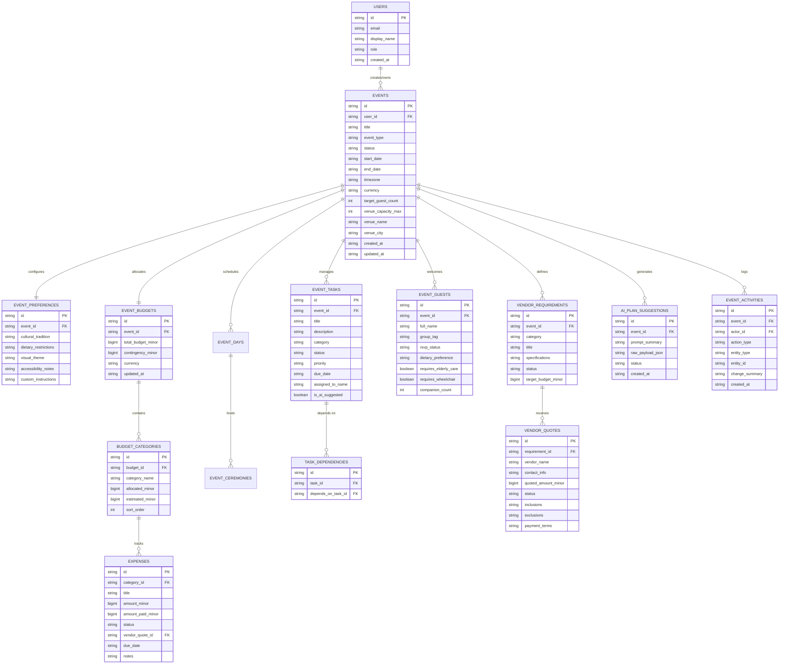

# Gatherly AI — Data Model Reference

This document specifies the database schema, entity relationships, integrity constraints, and domain types for **Gatherly AI**.

---

## 1. Entity Relationship Diagram

---

## 2. Table Definitions

### 2.1 `users`
Represents registered organizers, clients, and planners.
- `id`: `TEXT PRIMARY KEY` (Prefixed UUID `usr_<uuid>`)
- `email`: `TEXT NOT NULL UNIQUE`
- `display_name`: `TEXT NOT NULL`
- `role`: `TEXT NOT NULL DEFAULT 'INDIVIDUAL'` (`'INDIVIDUAL'`, `'PLANNER'`, `'ADMIN'`)
- `created_at`: `TEXT NOT NULL` (ISO 8601)

### 2.2 `events`
Root aggregate entity for every planning project.
- `id`: `TEXT PRIMARY KEY` (`evt_<uuid>`)
- `user_id`: `TEXT NOT NULL REFERENCES users(id) ON DELETE CASCADE`
- `title`: `TEXT NOT NULL` (e.g., "Priya & Rohan's Gujarati Wedding")
- `event_type`: `TEXT NOT NULL` (`'WEDDING'`, `'BIRTHDAY'`, `'CELEBRATION'`, `'COMMUNITY'`, `'CORPORATE'`)
- `status`: `TEXT NOT NULL DEFAULT 'PLANNING'` (`'DRAFT'`, `'PLANNING'`, `'CONFIRMED'`, `'COMPLETED'`, `'ARCHIVED'`)
- `start_date`: `TEXT NOT NULL` (ISO 8601 Date or Datetime, e.g., `2026-11-20`)
- `end_date`: `TEXT NOT NULL` (ISO 8601 Date or Datetime, e.g., `2026-11-22`)
- `timezone`: `TEXT NOT NULL DEFAULT 'Asia/Kolkata'`
- `currency`: `TEXT NOT NULL DEFAULT 'INR'` (`'INR'`, `'USD'`, `'EUR'`, `'GBP'`, `'AED'`)
- `target_guest_count`: `INTEGER NOT NULL DEFAULT 100`
- `venue_capacity_max`: `INTEGER NULLABLE` (Enables automated capacity overflow alerts)
- `venue_name`: `TEXT NULLABLE`
- `venue_city`: `TEXT NOT NULL DEFAULT 'Ahmedabad'`
- `created_at`: `TEXT NOT NULL`
- `updated_at`: `TEXT NOT NULL`

### 2.3 `event_preferences`
Captures cultural, dietary, and accessibility parameters that guide AI generation and domain rules.
- `id`: `TEXT PRIMARY KEY` (`pref_<uuid>`)
- `event_id`: `TEXT NOT NULL UNIQUE REFERENCES events(id) ON DELETE CASCADE`
- `cultural_tradition`: `TEXT NULLABLE` (e.g., `'Gujarati'`, `'Punjabi'`, `'South Indian Tamil'`, `'Bengali'`, `'Western Modern'`)
- `dietary_restrictions`: `TEXT NOT NULL DEFAULT 'PURE_VEG'` (`'PURE_VEG'`, `'JAIN'`, `'VEGETARIAN'`, `'NON_VEG_INCLUDED'`, `'HALAL'`, `'VEGAN'`)
- `visual_theme`: `TEXT NULLABLE` (e.g., "Vibrant Marigold & Royal Teal, Contemporary Gujarati Festive")
- `accessibility_notes`: `TEXT NULLABLE` (e.g., "Elderly seating near mandap, wheelchair ramp required at dining hall entrance")
- `custom_instructions`: `TEXT NULLABLE`

### 2.4 `event_budgets` & `budget_categories`
Stores financial constraints using integer minor-units (paise/cents) to eliminate floating-point drift.
- `event_budgets`:
  - `id`: `TEXT PRIMARY KEY` (`bdg_<uuid>`)
  - `event_id`: `TEXT NOT NULL UNIQUE REFERENCES events(id) ON DELETE CASCADE`
  - `total_budget_minor`: `INTEGER/BIGINT NOT NULL` (e.g., `120000000` = ₹12,00,000)
  - `contingency_minor`: `INTEGER/BIGINT NOT NULL DEFAULT 0` (e.g., 10% reserve)
  - `currency`: `TEXT NOT NULL DEFAULT 'INR'`
  - `updated_at`: `TEXT NOT NULL`
- `budget_categories`:
  - `id`: `TEXT PRIMARY KEY` (`cat_<uuid>`)
  - `budget_id`: `TEXT NOT NULL REFERENCES event_budgets(id) ON DELETE CASCADE`
  - `category_name`: `TEXT NOT NULL` (e.g., `'Catering'`, `'Venue'`, `'Decor & Flowers'`, `'Photography & Video'`, `'Attire & Jewelry'`, `'Entertainment & Music'`, `'Invitations & Gifts'`)
  - `allocated_minor`: `INTEGER/BIGINT NOT NULL DEFAULT 0` (Target spending cap)
  - `estimated_minor`: `INTEGER/BIGINT NOT NULL DEFAULT 0` (Initial AI or user estimate)
  - `sort_order`: `INTEGER NOT NULL DEFAULT 0`

### 2.5 `expenses`
Discrete, traceable expenditure items linked to categories.
- `id`: `TEXT PRIMARY KEY` (`exp_<uuid>`)
- `category_id`: `TEXT NOT NULL REFERENCES budget_categories(id) ON DELETE CASCADE`
- `title`: `TEXT NOT NULL` (e.g., "Catering Advance (50% booking deposit)")
- `amount_minor`: `INTEGER/BIGINT NOT NULL` (Agreed cost)
- `amount_paid_minor`: `INTEGER/BIGINT NOT NULL DEFAULT 0` (Disbursed to date)
- `status`: `TEXT NOT NULL DEFAULT 'ESTIMATED'` (`'ESTIMATED'`, `'COMMITTED'`, `'PAID'`, `'CANCELLED'`)
- `vendor_quote_id`: `TEXT NULLABLE REFERENCES vendor_quotes(id) ON DELETE SET NULL`
- `due_date`: `TEXT NULLABLE`
- `notes`: `TEXT NULLABLE`

### 2.6 `event_tasks` & `task_dependencies`
Actionable checklist items with strict state transitions and dependency chains.
- `event_tasks`:
  - `id`: `TEXT PRIMARY KEY` (`tsk_<uuid>`)
  - `event_id`: `TEXT NOT NULL REFERENCES events(id) ON DELETE CASCADE`
  - `title`: `TEXT NOT NULL`
  - `description`: `TEXT NULLABLE`
  - `category`: `TEXT NOT NULL DEFAULT 'GENERAL'` (`'VENUE'`, `'CATERING'`, `'DECOR'`, `'LOGISTICS'`, `'LEGAL_PERMITS'`, `'ATTIRE'`, `'INVITES'`)
  - `status`: `TEXT NOT NULL DEFAULT 'TODO'` (`'TODO'`, `'IN_PROGRESS'`, `'BLOCKED'`, `'DONE'`)
  - `priority`: `TEXT NOT NULL DEFAULT 'MEDIUM'` (`'LOW'`, `'MEDIUM'`, `'HIGH'`, `'CRITICAL'`)
  - `due_date`: `TEXT NULLABLE` (ISO 8601 Date)
  - `assigned_to_name`: `TEXT NULLABLE` (e.g., "Rohan's Uncle", "Priya")
  - `is_ai_suggested`: `BOOLEAN NOT NULL DEFAULT FALSE`
- `task_dependencies`:
  - `id`: `TEXT PRIMARY KEY` (`dep_<uuid>`)
  - `task_id`: `TEXT NOT NULL REFERENCES event_tasks(id) ON DELETE CASCADE`
  - `depends_on_task_id`: `TEXT NOT NULL REFERENCES event_tasks(id) ON DELETE CASCADE`

### 2.7 `event_guests`
Guest count, categorization, and accommodation flags.
- `id`: `TEXT PRIMARY KEY` (`gst_<uuid>`)
- `event_id`: `TEXT NOT NULL REFERENCES events(id) ON DELETE CASCADE`
- `full_name`: `TEXT NOT NULL`
- `group_tag`: `TEXT NOT NULL DEFAULT 'FAMILY'` (`'BRIDE_FAMILY'`, `'GROOM_FAMILY'`, `'FRIENDS'`, `'COMMUNITY'`, `'VIP'`)
- `rsvp_status`: `TEXT NOT NULL DEFAULT 'INVITED'` (`'INVITED'`, `'CONFIRMED'`, `'DECLINED'`, `'TENTATIVE'`)
- `dietary_preference`: `TEXT NOT NULL DEFAULT 'STANDARD'` (`'STANDARD'`, `'JAIN'`, `'PURE_VEG'`, `'VEGAN'`, `'HALAL'`)
- `requires_elderly_care`: `BOOLEAN NOT NULL DEFAULT FALSE`
- `requires_wheelchair`: `BOOLEAN NOT NULL DEFAULT FALSE`
- `companion_count`: `INTEGER NOT NULL DEFAULT 0`

### 2.8 `vendor_requirements` & `vendor_quotes`
Traceable vendor bid management.
- `vendor_requirements`:
  - `id`: `TEXT PRIMARY KEY` (`vrq_<uuid>`)
  - `event_id`: `TEXT NOT NULL REFERENCES events(id) ON DELETE CASCADE`
  - `category`: `TEXT NOT NULL`
  - `title`: `TEXT NOT NULL`
  - `specifications`: `TEXT NOT NULL`
  - `status`: `TEXT NOT NULL DEFAULT 'OPEN'` (`'OPEN'`, `'QUOTES_RECEIVED'`, `'AWARDED'`, `'CANCELLED'`)
  - `target_budget_minor`: `INTEGER/BIGINT NOT NULL DEFAULT 0`
- `vendor_quotes`:
  - `id`: `TEXT PRIMARY KEY` (`vqt_<uuid>`)
  - `requirement_id`: `TEXT NOT NULL REFERENCES vendor_requirements(id) ON DELETE CASCADE`
  - `vendor_name`: `TEXT NOT NULL`
  - `contact_info`: `TEXT NULLABLE`
  - `quoted_amount_minor`: `INTEGER/BIGINT NOT NULL`
  - `status`: `TEXT NOT NULL DEFAULT 'RECEIVED'` (`'RECEIVED'`, `'SHORTLISTED'`, `'CONFIRMED'`, `'DECLINED'`)
  - `inclusions`: `TEXT NULLABLE`
  - `exclusions`: `TEXT NULLABLE`
  - `payment_terms`: `TEXT NULLABLE`

### 2.9 `ai_plan_suggestions`
Uncommitted AI draft recommendations pending user acceptance.
- `id`: `TEXT PRIMARY KEY` (`sug_<uuid>`)
- `event_id`: `TEXT NOT NULL REFERENCES events(id) ON DELETE CASCADE`
- `prompt_summary`: `TEXT NOT NULL`
- `raw_payload_json`: `TEXT NOT NULL` (Validated JSON containing categories, tasks, milestones)
- `status`: `TEXT NOT NULL DEFAULT 'PENDING_REVIEW'` (`'PENDING_REVIEW'`, `'ACCEPTED'`, `'REJECTED'`, `'SUPERSEDED'`)
- `created_at`: `TEXT NOT NULL`

### 2.10 `event_activities` (Audit & Change Intelligence Log)
- `id`: `TEXT PRIMARY KEY` (`act_<uuid>`)
- `event_id`: `TEXT NOT NULL REFERENCES events(id) ON DELETE CASCADE`
- `actor_id`: `TEXT NOT NULL`
- `action_type`: `TEXT NOT NULL` (`'PLAN_GENERATED'`, `'GUEST_COUNT_CHANGED'`, `'DATE_SHIFTED'`, `'BUDGET_REALLOCATED'`, `'QUOTE_CONFIRMED'`)
- `entity_type`: `TEXT NOT NULL`
- `entity_id`: `TEXT NOT NULL`
- `change_summary`: `TEXT NOT NULL`
- `created_at`: `TEXT NOT NULL`

---

## 3. Financial Invariants & Rules

1. **Allocated Total Invariant:**
   $$\sum \text{allocated\_minor} + \text{contingency\_minor} \le \text{total\_budget\_minor}$$
   *(If sum exceeds total, UI highlights warning state with exact deficit).*
2. **Actual Spent Computation:**
   $$\text{Total Paid} = \sum \text{amount\_paid\_minor for status} \in \{\text{'COMMITTED'}, \text{'PAID'}\}$$
3. **Paise Minor Unit Integrity:**
   All API endpoints accept and return money as integers or formatted strings. Fractional amounts (e.g. `1250000.55`) are rejected by Zod schema validation.
