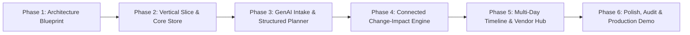

# Gatherly AI — Phased Implementation Roadmap

This roadmap breaks down the development of Gatherly AI into 6 disciplined, testable, and demonstrable phases.

---

## Roadmap Overview

---

## Detailed Phase Breakdown

### Phase 1: Product Understanding, Repository Inspection & Blueprint (Current Phase)
- **Objective:** Establish the product foundation, inspect runtime environment, define technical architecture, data model, security perimeter, and execution roadmap.
- **Scope:** Repository inspection, architectural documents, data schemas, evaluation criteria, threat model, Phase 2 implementation prompt.
- **Deliverables:**
  - `docs/PRODUCT_SPEC.md`
  - `docs/ARCHITECTURE.md`
  - `docs/DATA_MODEL.md`
  - `docs/SECURITY_AND_PRIVACY.md`
  - `docs/EVALUATION_RUBRIC.md`
  - `docs/ROADMAP.md`
  - `README.md` & `.gitignore`
- **Definition of Done:** All architecture documents written, git initialized, clean environment verified, Phase 2 copy-paste prompt prepared.

---

### Phase 2: Project Scaffold & First Functional Vertical Slice
- **Objective:** Bootstrap the working project, configure TypeScript, Next.js App Router, Tailwind CSS, Drizzle ORM, SQLite database, and deliver the first end-to-end persistent vertical slice.
- **Scope:**
  - Project initialization with Next.js 15+, React 19, Tailwind CSS.
  - Drizzle ORM configuration with SQLite database (`data/gatherly.db`).
  - Core database schema: `events`, `event_budgets`, `budget_categories`, `expenses`, `event_tasks`.
  - First Functional Vertical Slice:
    1. Create Event form (Title, Type, Date, City, Guest Count, Planned Budget).
    2. Deterministic calculation and persistent storage of initial budget categories and starter tasks.
    3. Event Command Center dashboard displaying the created event, live budget progress bar (in INR ₹), and task checklist.
    4. Ability to add/edit a budget allocation or toggle a task status with persistent state.
    5. Automated Vitest test suite verifying deterministic financial arithmetic and CRUD persistence.
- **Acceptance Criteria:** A user can create an event, view it on the dashboard, update a budget category, refresh the browser, and see exact persisted numbers.

---

### Phase 3: GenAI Event Planning & Intake Engine
- **Objective:** Connect Google Gemini via the official `@google/genai` SDK to enable natural-language event planning with runtime Zod schema validation.
- **Scope:**
  - Google GenAI SDK integration (`gemini-2.5-flash`).
  - Natural-language intake wizard with cultural presets (e.g. Gujarati, Punjabi, South Indian, Modern Celebration).
  - Structured output generation: Generates tailored multi-day itinerary, suggested budget allocations, task checklist, and vendor criteria.
  - **Reviewable Suggestions Workspace:** Shows the AI proposal side-by-side with accept/reject/modify controls before saving to database.
  - Fallback template provider for offline/rate-limited operation.
- **Acceptance Criteria:** Typing "Plan a 2-day Gujarati wedding in Ahmedabad for 250 guests with a ₹12 Lakh budget" generates a structured, culturally accurate plan validated by Zod and saved as an uncommitted draft for user review.

---

### Phase 4: Connected Event Planning & Explainable Change-Impact Engine
- **Objective:** Build the flagship product differentiator: relational change-impact detection and explainable intelligence.
- **Scope:**
  - Deterministic Rule Engine for change impact analysis:
    - Guest count scaling: Adjusts catering estimates, checks venue capacity limits, flags seating/invitation tasks.
    - Date shifts: Recomputes milestone deadlines, flags conflicting vendor booking windows.
    - Budget cap modifications: Identifies category deficits and suggests proportional reallocations.
  - Explainable Impact Card UI: Highlights what changed, which assumptions are affected, which numbers are estimates, and what decisions are required.
  - Activity audit logging in `event_activities`.
- **Acceptance Criteria:** Changing guest count from 250 to 320 automatically generates a clear, deterministic impact warning with catering delta and venue capacity alerts without corrupting confirmed budget numbers.

---

### Phase 5: Multi-Day Timeline, Vendor Quotation Analyzer & Cultural Customization
- **Objective:** Expand the operational depth with multi-day ceremony scheduling, vendor RFP & quote comparison, and dietary/accessibility management.
- **Scope:**
  - Multi-Day Timeline View: Day 1 (Mehendi & Sangeet), Day 2 (Haldi, Wedding, Reception) with time-slotted schedules.
  - Vendor RFP & Quotation Hub: Track vendor requirements, upload/enter vendor quotes, side-by-side comparison of inclusions, exclusions, and payment milestones.
  - Guest & Dietary Tracker: Pure Veg, Jain, Non-Veg tracking, elderly accommodation indicators, wheelchair accessibility flags.
- **Acceptance Criteria:** User can compare two caterer quotes side-by-side, mark one as confirmed, and observe the expense lock into the budget.

---

### Phase 6: Hardening, WCAG AA Accessibility, Verification & Demo Delivery
- **Objective:** Polish user interface, conduct security and accessibility audits, run full verification, and package a rock-solid demonstration.
- **Scope:**
  - WCAG 2.2 AA accessibility audit (contrast, keyboard navigation, aria-labels).
  - Responsive polish across mobile (320px), tablet (768px), and desktop (1440px).
  - Comprehensive verification script: `npm run verify` (`type-check`, `lint`, `test`, `build`).
  - Interactive Demo Script & Pre-seeded high-quality demo event (Ahmedabad Gujarati Wedding).
  - Final documentation update and deployment readiness check.
- **Acceptance Criteria:** Zero lint/type errors, 100% passing tests, flawless responsive UI, smooth 3-minute video/live presentation workflow.
