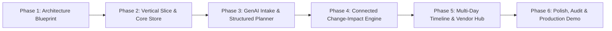

# Gatherly AI — Phased Implementation Roadmap

This roadmap breaks down the development of Gatherly AI into 6 disciplined, testable, and demonstrable phases.

---

## Roadmap Overview

---

## Detailed Phase Breakdown

### Phase 1: Product Understanding, Repository Inspection & Blueprint (Current Phase)
- **Objective:** Establish the product foundation, inspect runtime environment, define technical architecture, data model, security perimeter, and execution roadmap.
- **Scope:** Repository inspection, architectural documents, data schemas, evaluation criteria, threat model, Phase 2 implementation prompt.
- **Deliverables:**
  - `docs/PRODUCT_SPEC.md`
  - `docs/ARCHITECTURE.md`
  - `docs/DATA_MODEL.md`
  - `docs/SECURITY_AND_PRIVACY.md`
  - `docs/EVALUATION_RUBRIC.md`
  - `docs/ROADMAP.md`
  - `README.md` & `.gitignore`
- **Definition of Done:** All architecture documents written, git initialized, clean environment verified, Phase 2 copy-paste prompt prepared.

---

### Phase 2: Project Scaffold & First Functional Vertical Slice (COMPLETED ✓)
- **Objective:** Bootstrap the working project, configure TypeScript, Next.js App Router, Tailwind CSS, Drizzle ORM, SQLite database, and deliver the first end-to-end persistent vertical slice.
- **Scope & Results:**
  - [x] Project initialization with Next.js 16, React 19, TypeScript strict mode, Tailwind CSS.
  - [x] Drizzle ORM configured with SQLite database (`data/gatherly.db`) and versioned SQL migrations (`src/lib/db/migrations/0000_colorful_pyro.sql`).
  - [x] Foreign-key cascade constraints and indexes implemented across `events`, `event_budgets`, `budget_categories`, and `event_tasks`.
  - [x] Deterministic budget domain engine implemented in `src/lib/domain/budget.ts` with integer paise arithmetic and over-budget detection.
  - [x] Indian currency formatting (`formatINR`, `formatCompactINR` in Lakhs/Crores) and date formatting (`Asia/Kolkata`).
  - [x] Deterministic initial seeding for Weddings, Birthdays, and Community events inside atomic transactions.
  - [x] Landing page with active events list, 1-click Gujarati wedding demo seeder, and "+ Plan New Event" navigation.
  - [x] Event creation wizard with client & server-side Zod validation.
  - [x] Event Command Center (`/events/[id]`): live budget metrics, category allocation editor, interactive task toggle checklist, and next recommended actions.
  - [x] Automated test suite: 41 passing tests (unit, integration, and API tests).
  - [x] Complete verification suite passing (`npm run verify`: type-check, lint, test, build).
- **Definition of Done:** 100% verified and demonstrable. All changes persist across reloads.

---

### Phase 3: GenAI Event Planning & Intake Engine (COMPLETED ✓)
- **Objective:** Connect Google Gemini via the official `@google/genai` SDK to enable natural-language event planning with runtime Zod schema validation, reviewable staged suggestions, and safe acceptance into the live workspace.
- **Scope & Results:**
  - [x] `@google/genai` SDK v2.32.0 integrated (`gemini-2.5-flash`).
  - [x] Server-side only AI calls — `GEMINI_API_KEY` never exposed to browser bundle.
  - [x] Prompt injection defense: user-supplied `<system>` tags are stripped before the prompt is sent.
  - [x] Structured Zod schema validation on every AI response before any write occurs.
  - [x] `ai_plan_suggestions` staging table with status trail: `PENDING_REVIEW` → `ACCEPTED` / `PARTIALLY_ACCEPTED` / `REJECTED`.
  - [x] Deterministic starter template fallback: honestly labelled `modelUsed: 'deterministic-starter-template'`, never claimed as AI output.
  - [x] AI Planner tab on event dashboard: generates plan, shows concept / personalization / budget / tasks sections with per-item checkboxes.
  - [x] Accept All / Accept Selected / Reject All — idempotent acceptance (duplicate task prevention).
  - [x] Accepted suggestions propagate to budget categories and task checklist atomically.
  - [x] Budget model invariant fixed: `sum(categories) + contingency = totalBudget` guaranteed.
  - [x] `src/lib/auth/session.ts` documents demo mode, warns in production environments.
  - [x] `.env.example` added with all configurable keys documented.
  - [x] 69 tests passing (9 files: unit AI service, budget regression, formatting, seeding; integration plan-review, AI API, events, API).
  - [x] Complete verification passing (`npm run verify`: type-check, lint, test, build).
- **Definition of Done:** Fully verified. Users can describe an event in natural language, review AI-generated categories and tasks, selectively accept, and see them reflected in their live workspace.

---

### Phase 4: Connected Event Planning & Explainable Change-Impact Engine (COMPLETED ✓)
- **Objective:** Build the flagship product differentiator: relational change-impact detection and explainable intelligence with a two-stage preview & confirm workflow, optimistic concurrency, and audit provenance.
- **Scope & Results:**
  - [x] Deterministic Rule Engine for change impact analysis:
    - Guest count scaling: Scales catering based on established per-guest rate (~₹/guest), flags other categories (Decor, Stationery, Favors) for review without fabricating numbers, raises venue capacity warnings when increase exceeds 20%.
    - Date shifts: Calculates calendar day difference (`diffDays`), shifts incomplete milestone task due dates proportionally with opt-in checkboxes, preserves completed tasks (`DONE`), detects invalid/reversed date ranges, warns on short notice windows.
    - Budget cap modifications: Computes available pool and contingency, identifies category deficits with exact amounts, flags unallocated surpluses without altering commitments.
    - City relocation: Identifies vendor, travel, and logistics re-verification requirements.
  - [x] Two-Stage Preview & Confirm Workflow:
    - Stage 1 (Preview): Computes explainable findings on an immutable snapshot. Database is never mutated.
    - Stage 2 (Confirm): Atomically applies primary requirement updates and user-selected side-effects in a single SQLite transaction.
  - [x] Stale State & Concurrency Protection:
    - Optimistic concurrency control via `version` column on events.
    - Rejects stale preview confirmations with HTTP 409 Conflict if workspace was modified in the interim.
  - [x] Activity Audit Logging & Provenance:
    - `event_activities` table records all confirmed requirement changes with actor attribution, previous/new JSON snapshots, and approved side-effect lists.
    - Interactive history timeline on the dashboard with expandable technical snapshots.
  - [x] UI Dashboard Integration:
    - "Change Impact & History" tab and quick header banner link.
    - Per-item findings cards with opt-in side-effect checkboxes.
  - [x] Automated Test Suite: 95 passing tests across 12 test files (26 new Phase 4 tests).
  - [x] Complete verification passing (`npm run verify`: type-check, lint, test, build).
- **Definition of Done:** 100% verified and demonstrable. Changing event requirements previews consequences without mutating data; user confirmation persists changes atomically with full audit history.

---

### Phase 5: Multi-Day Timeline, Vendor Quotation Analyzer & Cultural Customization
- **Objective:** Expand the operational depth with multi-day ceremony scheduling, vendor RFP & quote comparison, and dietary/accessibility management.
- **Scope:**
  - Multi-Day Timeline View: Day 1 (Mehendi & Sangeet), Day 2 (Haldi, Wedding, Reception) with time-slotted schedules.
  - Vendor RFP & Quotation Hub: Track vendor requirements, upload/enter vendor quotes, side-by-side comparison of inclusions, exclusions, and payment milestones.
  - Guest & Dietary Tracker: Pure Veg, Jain, Non-Veg tracking, elderly accommodation indicators, wheelchair accessibility flags.
- **Acceptance Criteria:** User can compare two caterer quotes side-by-side, mark one as confirmed, and observe the expense lock into the budget.

---

### Phase 6: Hardening, WCAG AA Accessibility, Verification & Demo Delivery
- **Objective:** Polish user interface, conduct security and accessibility audits, run full verification, and package a rock-solid demonstration.
- **Scope:**
  - WCAG 2.2 AA accessibility audit (contrast, keyboard navigation, aria-labels).
  - Responsive polish across mobile (320px), tablet (768px), and desktop (1440px).
  - Comprehensive verification script: `npm run verify` (`type-check`, `lint`, `test`, `build`).
  - Interactive Demo Script & Pre-seeded high-quality demo event (Ahmedabad Gujarati Wedding).
  - Final documentation update and deployment readiness check.
- **Acceptance Criteria:** Zero lint/type errors, 100% passing tests, flawless responsive UI, smooth 3-minute video/live presentation workflow.
